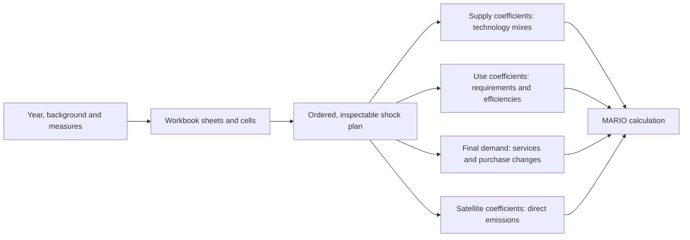

# FULFILL sufficiency model

Explore how changes in diets, housing, mobility, aviation and product sharing
affect a hybrid, multi-regional input–output model of Europe and the world.
Choose an energy background and year, combine sufficiency measures, inspect
their instructions, and run the full model with MARIO.

This is the model accompanying Golinucci et al., **The role of sufficiency
measures in a decarbonizing Europe**, *Ecological Economics* 235 (2025), 108645.
[Paper](https://doi.org/10.1016/j.ecolecon.2025.108645) ·
[Fixed data release v2.3](https://doi.org/10.5281/zenodo.15341618)

## Start here

Use a **dedicated Python 3.12 environment**. This repository retains **MARIO
0.3.5**, the paper's engine; installing it into an environment used by a newer
MARIO model would replace that version.

```bash
python3.12 -m venv .venv
source .venv/bin/activate
python -m pip install -e '.[model,notebook]'
```

Alternatively, create a conda environment with Python 3.12 and run the same pip
command. See [installation](docs/installation.md).

1. Open [Explore sufficiency](notebooks/Explore_sufficiency.ipynb) to see real
   input values, source cells and their translation into MARIO instructions.
   It downloads only **1.75 MB** of shock assumptions and does not solve the IO
   model.
2. Open [Run the sufficiency model](notebooks/Run_sufficiency.ipynb), or run the
   command below, to calculate the selected scenario and its no-measure control.
   The full database downloads automatically when needed (**127.8 MB**, roughly
   1.25 GB extracted). Subsequent runs reuse checked local files.

```bash
fulfill run --case config/paper-all.json --air-transport-extra \
  --output Outputs/runs/my-first-comparison
```

This selects **NZE, 2050, all six measures**, and compares it with **NZE, 2050,
no measures**. It does not compare a projected scenario with unprojected 2011.
The final local check took about two minutes per scenario, plus the initial
database load (about 25 seconds in the first check). Allow roughly five minutes
for this two-case comparison, excluding the first download. Hardware and BLAS
settings affect these timings.

`--air-transport-extra` explicitly applies the extra aviation-emissions account
from the original database-building notebook. That account is missing from the
ready-made Zenodo ZIP. Without the flag, the published ZIP's accounts are used
unchanged. The selected variant is recorded in each run.

## Choose and combine measures

| Code | Measure | What changes |
| --- | --- | --- |
| D | Plant-based diets | Shares of meal-producing activities |
| S | Smaller/shared living spaces | Housing-service demand per person |
| M | Smaller cars | Fuel requirements **and** direct vehicle emissions |
| P | Shared washing machines | Additive changes to equipment purchases **and** household electricity |
| F | Less air travel | Household demand **and** intermediate use of air transport |
| B | More cycling | Car-mobility demand per person |

Backgrounds: `REF`, `NZE`, `BAU`. Years: `2011`, `2020`, `2025`, `2030`, `2035`,
`2040`, `2045`, `2050`. No interpolation between years is inferred.

Edit a copy of [this example](config/diet-and-aviation.json):

```json
{
  "name": "diet-and-aviation-2050",
  "background": "NZE",
  "year": 2050,
  "measures": ["D", "F"],
  "adoption": {"D": 1.0, "F": 0.5}
}
```

Here `F: 0.5` moves each aviation instruction halfway between the no-measure
and full-measure assumptions **at the same year/background**. It does not mean
“halve all flights”, and it does not interpolate final model results. Paired
effects remain coupled. These are exploratory adoption controls, not adoption
trajectories estimated in the paper.

Inspect before calculating:

```bash
fulfill plan --case config/diet-and-aviation.json \
  --output Outputs/plans/diet-and-aviation
fulfill run --case config/diet-and-aviation.json --air-transport-extra \
  --output Outputs/runs/diet-and-aviation
```

For different numerical assumptions, copy the downloaded shock workbooks and
pass `--inputs /path/to/my-workbooks`. Original source files stay intact.
[Scenario guide](docs/scenarios.md) · [Python API](docs/api.md)

## Understand the shock mechanism



`steps.csv` explains the 18 ordered steps. `shock_rows.csv` records source
cells, values, population multipliers, origin weights and adoption controls.
`z.csv`, `Y.csv`, `e.csv` are the actual instructions sent to MARIO. In this
historical SUT adapter, `z` contains both supply and use coefficients.

Full runs also export `accounts.csv`, `production.csv` and `run.json`; paired
runs add `comparison.csv`. These are production accounts by region, direct
final-demand accounts and sectoral quantities in their original units. They
are **not** labelled as consumption footprints or a reproduction of all paper
figures. [Output definitions](docs/results.md)

## Reproduce the historical study

The original three notebooks, `_support.py`, mappings, inventories and all
**192 saved shock workbooks** remain unchanged. Use the frozen workbooks when
you need exactly the historical instructions:

```bash
fulfill reproduce --background NZE --measure All --year 2050 \
  --air-transport-extra --output Outputs/runs/paper-NZE-2050
```

The distinction matters: **24 historical BAU cases differ from ShockMap's
declared measure selection**. The composable model follows the declared recipe;
`reproduce` preserves those files verbatim. Five BAU input sheets are absent from the
public ZIP. For those background blocks, the model reads the matching
instructions from the already-public BAU_0 workbooks, with source-cell and hash
provenance. No unpublished archive tables are bundled.

[Paper reproduction and database preparation](docs/paper-reproduction.md) ·
[Verification and known differences](docs/verification.md)

The full grid is an explicit choice; it is never launched by the quick start:

```bash
fulfill batch --paper-grid --frozen --air-transport-extra \
  --output Outputs/runs/paper-grid
```

The historical README estimated about eight hours for the complete calculation
and exports on an M3 Pro. This update does not certify a new full-grid runtime.
Use `--resume` to reuse completed cases after integrity checks.

## Toward reusable MARIO shock archetypes

[The archetype catalogue](docs/shock-archetypes.md) maps the FULFILL operations
to their meanings, matrix effects, dependencies and validation needs. It is the
starting point for discussing MARIO's shock API. This PR adds the model-facing
composition layer here; it does not change MARIO's core API.

## Citation and data

Golinucci, N., Rocco, M. V., Prina, M. G., Beltrami, F., Rinaldi, L., Schau,
E. M., & Sparber, W. (2025). The role of sufficiency measures in a decarbonizing
Europe. *Ecological Economics, 235*, 108645.
[doi:10.1016/j.ecolecon.2025.108645](https://doi.org/10.1016/j.ecolecon.2025.108645).

Code retains the repository's [Apache 2.0 license](LICENSE). The fixed Zenodo
dataset is distributed under CC BY 4.0. See [data sources](docs/data.md).
